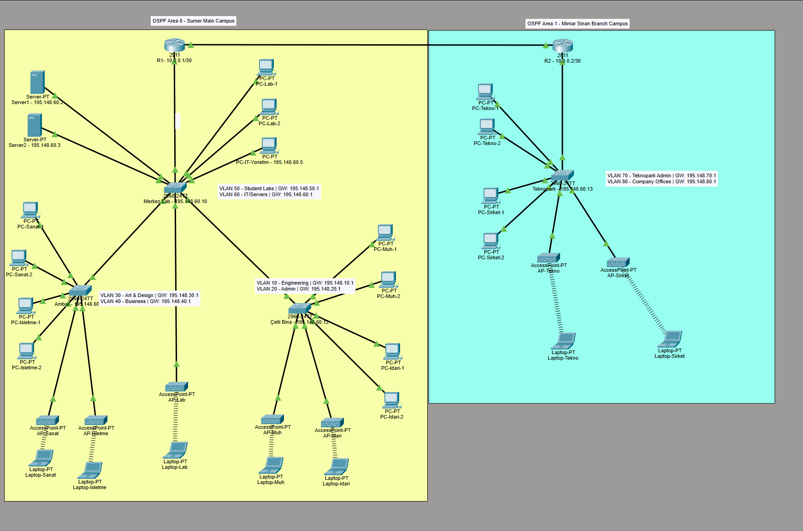

# AGÜ Campus Network — Design & Implementation

A two-campus enterprise network for Abdullah Gül University (AGÜ), designed, configured and tested in **Cisco Packet Tracer**.

The network connects the **Sümer (main)** and **Mimar Sinan (branch)** campuses over a WAN link. It covers VLAN segmentation, Router-on-a-Stick inter-VLAN routing, multi-area OSPFv2, centralized DHCP with relay, DNS/Web/E-mail services, wireless access, SSH-only management, port security and extended ACLs.

> Group project for **COMP 308 — Computer Networks**, Abdullah Gül University, 2025-26 Spring.

## Contents

| Path | Description |
| --- | --- |
| [`packet-tracer/agu-campus-network.pkt`](packet-tracer/agu-campus-network.pkt) | The complete Packet Tracer simulation |
| [`docs/AGU_Campus_Network_Report.pdf`](docs/AGU_Campus_Network_Report.pdf) | Full project report (design, configuration, tests, evaluation) |
| [`tests/`](tests/) | Screenshots for each verification test |

## How to open

1. Install [Cisco Packet Tracer](https://www.netacad.com/cisco-packet-tracer). It's free with a Cisco Networking Academy account.
2. Open `packet-tracer/agu-campus-network.pkt`.

## Requirements

The project brief asked for:

- Two campuses connected by a WAN link, with multiple buildings per campus.
- One VLAN per faculty or department, so their traffic stays isolated.
- A central server room (Merkez Lab) providing DHCP, DNS, E-mail and Web services to the whole university.
- OSPFv2 dynamic routing, with **Area 0** at the main campus and **Area 1** at the branch.
- Teknopark company offices isolated from the internal academic network with ACLs.
- Secure device management, port security and wireless access.

## Design

### Campuses and buildings

| Campus | Building | Units | VLANs |
| --- | --- | --- | --- |
| Sümer (Main) | Çelik Bina | Faculty of Engineering, Administrative Offices | 10, 20 |
| Sümer (Main) | Ambar | Faculty of Art & Design, Faculty of Business | 30, 40 |
| Sümer (Main) | Merkez Lab | Student Labs, IT / Server Room | 50, 60 |
| Mimar Sinan (Branch) | Teknopark | Teknopark Administration, Company Offices | 70, 80 |

### Addressing

Each VLAN gets its own `/24` from `195.148.0.0`. In every subnet, `.1` is the gateway (a router sub-interface), `.2–.9` is reserved for static devices, and `.10–.254` is the DHCP pool.

| VLAN | Department | Subnet | Gateway |
| --- | --- | --- | --- |
| 10 | Faculty of Engineering | 195.148.10.0/24 | 195.148.10.1 |
| 20 | Administrative Offices | 195.148.20.0/24 | 195.148.20.1 |
| 30 | Art & Design | 195.148.30.0/24 | 195.148.30.1 |
| 40 | Faculty of Business | 195.148.40.0/24 | 195.148.40.1 |
| 50 | Student Labs | 195.148.50.0/24 | 195.148.50.1 |
| 60 | IT / Servers (static only) | 195.148.60.0/24 | 195.148.60.1 |
| 70 | Teknopark Admin | 195.148.70.0/24 | 195.148.70.1 |
| 80 | Company Offices | 195.148.80.0/24 | 195.148.80.1 |
| 99 | Native VLAN (all trunks) | — | — |

| Device / Link | Address | Role |
| --- | --- | --- |
| Server-1 | 195.148.60.2 | DHCP + DNS |
| Server-2 | 195.148.60.3 | Web + E-mail |
| IT Management PC | 195.148.60.5 | Management station |
| SW-Merkez / SW-Ambar / SW-Celik / SW-Teknopark | 195.148.60.10–.13 | Switch management (SSH) |
| R1 ↔ R2 WAN | 10.0.0.1/30 ↔ 10.0.0.2/30 | Inter-campus link |

### Features

- **VLANs and trunks:** 802.1Q trunks between switches. The native VLAN is moved from 1 to 99 to prevent VLAN hopping.
- **Inter-VLAN routing:** Router-on-a-Stick. R1 carries sub-interfaces for VLANs 10–60, and R2 carries sub-interfaces for VLANs 70–80.
- **OSPFv2:** Process 1, with Area 0 at the main campus and on the WAN link, and Area 1 at the branch. R2 acts as the ABR. Interfaces facing end devices are passive.
- **DHCP relay:** One central DHCP server holds a pool per VLAN. `ip helper-address 195.148.60.2` on each sub-interface lets branch clients get their addresses across the WAN.
- **Services:** DNS A records for `www.agu.edu.tr` and `mail.agu.edu.tr`, HTTP/HTTPS, and SMTP/POP3.
- **Wireless:** One WPA2-PSK access point per department, mapped to that department's VLAN.
- **Secure management:** SSHv2 only (Telnet disabled), local privilege-15 users and RSA keys.
- **Port security:** One MAC per access port, sticky learning and `shutdown` on violation.
- **ACLs on R2 (inbound):**
  - `COMPANY-ISOLATION` (VLAN 80) blocks all academic and IT VLANs (10–60).
  - `ADMIN-RESTRICT` (VLAN 70) allows only DNS/DHCP and the Web server, and denies the other internal VLANs.
  - VLAN 60 (IT) has no ACL, so IT staff keep full management access.

## Verification

All 13 tests passed. Details are in Section 4 of the [report](docs/AGU_Campus_Network_Report.pdf).

| # | Test | Expected result | Evidence |
| --- | --- | --- | --- |
| 1 | Intra-VLAN ping | 100% success | [screenshot](tests/Test01_intra_vlan_ping.png) |
| 2 | Inter-VLAN ping (VLAN 40 → VLAN 60) | 100% success | [screenshot](tests/Test02_inter_vlan_ping.png) |
| 3 | Cross-campus ping (VLAN 10 → VLAN 70) | Success via OSPF | [screenshot](tests/Test03_cross_campus_ping.png) |
| 4 | ACL: company PC → Engineering | Blocked | [screenshot](tests/Test04_acl_company_block.png) |
| 5 | ACL: Teknopark Admin → Web server | Permitted | [screenshot](tests/Test05c_acl_other_blocked.jpg) |
| 6 | DHCP in each VLAN | Correct IP / gateway / DNS | [screenshot](tests/Test06_dhcp_function.jpg) |
| 7 | DHCP relay to the branch campus | Address from the correct pool | [screenshot](tests/Test07_dhcp_relay_branch.jpg) |
| 8 | OSPF adjacency | Neighbors FULL | [screenshot](tests/Test08_ospf_neighbor.jpg) |
| 9 | OSPF routes | Branch subnets as `O IA` | [screenshot](tests/Test09_ospf_routes.jpg) |
| 10 | SSH from the IT PC | Session established | [screenshot](tests/Test10_ssh_session.png) |
| 11 | Telnet attempt | Connection refused | [screenshot](tests/Test11_telnet_blocked.png) |
| 12 | Port security violation | Port goes err-disabled | [screenshot](tests/Test12_port_security_cli.png) |
| 13 | Wireless client | IP from the correct VLAN | [screenshot](tests/Test13_wireless_ip.png) |

## Lessons learned

- Check which interface a trunk is really on with `show cdp neighbors` instead of guessing.
- A distribution switch needs every VLAN that passes through it, even ones with no local access ports.
- Both ends of an OSPF link must be in the same area. Otherwise the area IDs mismatch and no adjacency forms.
- ACL order matters: specific permits must come before general denies.

## Possible improvements

- A backup DHCP/DNS server for high availability.
- EtherChannel or redundant core links.
- A Layer 3 switch to take inter-VLAN routing off the routers.
- AAA/RADIUS authentication and centralized syslog.

## License

Licensed under [CC BY 4.0](LICENSE). You may reuse and adapt it with attribution.

If you're taking a similar course, use this as a reference, not as a submission.
